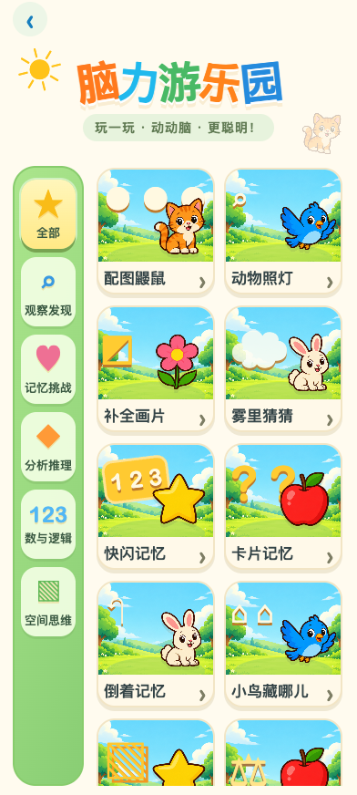
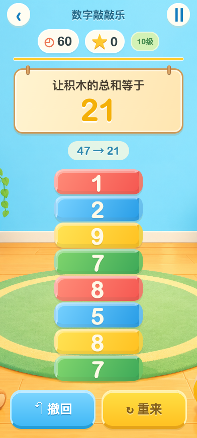
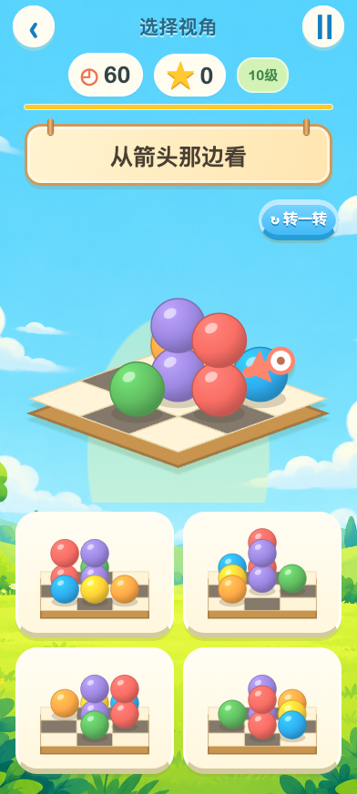

# 脑力游乐园：原型对齐与浏览器验收

本次重做全部20款玩法的实际界面。参考为 [原GPT三屏原型](../Design%20Brain%20School%2020/ui-prototype.png)，采用真实HTML按钮与SVG题目，不把带文字、假按钮的原型整图铺到游戏里。

## 与原型的对应

| 原型特征 | 实际落地 |
| --- | --- |
| 奶油色菜单、彩色标题、绿色分类栏 | 彩色“脑力游乐园”标题、六类立体选项、带场景和游戏图案的20张卡片；小屏六类都可见，卡片区独立滚动 |
| 明快天蓝天空、云与草地 | 原创无字草地背景用于室外玩法；主图与底部大选项融入场景 |
| 木制悬挂题目牌 | 20款真实题目统一使用奶油木牌，保持字体对比和短文字 |
| 数字积木、地毯、玩具教室 | 原创教室背景；可点击红/蓝/黄/绿数字积木；蓝色撤回、黄色重来；积木数量增多时字号随可用高度缩放 |
| 草地3D球和棋盘 | 选择视角按原3D坐标、相机和深度顺序绘制彩球及棋盘；多层球表达原高度，实际选项与题目使用同一渲染函数 |
| 大奶油选项、暖黄和蓝色操作 | 20款的选项、记忆卡、拼图块、轨道选择、确认按钮、暂停与结果页统一重做；长屏主图伸展，选项靠近底部 |

## 实际截图

| 菜单 | 数字积木 | 选择视角 |
| --- | --- | --- |
|  |  |  |

全部20款还保留320×568、392×872、568×320的高难度截图，文件名为 `brain-玩法id-宽x高.png`。小屏与横屏采用响应式布局；横屏以左右区域放置主图和选项，不硬裁整屏。

## 生成资产

- [meadow-sky.png](../../app/assets/brain-school/art/meadow-sky.png)：室外天空、云、草地、树与花。
- [toy-classroom.png](../../app/assets/brain-school/art/toy-classroom.png)：室内玩具教室、木地板与地毯。
- [sources.json](../../app/assets/brain-school/art/sources.json)：完整提示词、工具与来源路径。两张均由内置 `image_gen` 生成，1024×1536；已检查无UI字、假按钮和题目内容，按比例显示。
- 原 `sprites.png` 与 `core.js` 的精确source rect保持，避免图集串图和变形。

## 验证

命令均使用本机已有Playwright/Chrome，浏览器与上下文在finally关闭；未安装新增运行依赖。

| 验证 | 结果 |
| --- | --- |
| `node --test tests/brain-*.test.mjs` | 44项通过：随机、规则、评分、3D坐标和可见线索回归 |
| `node scripts/verify-brain-ui.mjs` | 20款×3视口×1/10级，共120题真实鼠标通过；0误触、0页面错误、0滚动溢出；确认全部可用控件可见且点击命中；含记忆隐藏后与照灯答案出现后的二次布局检查 |
| `verify-brain-school.mjs` | 识别/数字48题通过；下一题、计分、暂停、重开与存档边界 |
| `verify-brain-memory.mjs` | 26项通过，含实际菜单进入和分层返回 |
| `verify-brain-analysis.mjs` | 分析24题通过，含撤回与暂停 |
| 语法与限定范围 `git diff --check` | 通过 |

旧脚本新增 `BRAIN_QA_OUTPUT` 可选参数，本轮输出在此目录，未覆盖4.35的历史图片。可复核的JSON： [统一UI](brain-ui-layout.json)、[识别/数字](browser-identify-compute.json)、[记忆](memory-browser-qa.json)、[分析](analysis-browser-check.json)。

## 保持与边界

`core.js`、20款随机题生成、判定与计分均保持。新记录仍用 `rugeBrainSchoolV1/schema1`，保留分层返回、暂停、后台与封面禁止写存档行为。类别脚本仅调整数字塔的题目/排版和3D视角的SVG美术。`app.js`在集合、详情和开始时派发 `ruge:brain-game`，供统一音乐模块选曲；不内置第二套声音逻辑。

本文件记录桌面Chrome浏览器证据，不作为Android实体触摸、扬声器声音或正式APK验收；这部分由整体验收另行记录。
