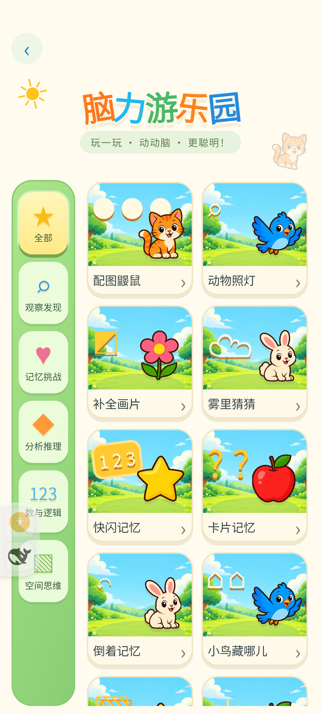
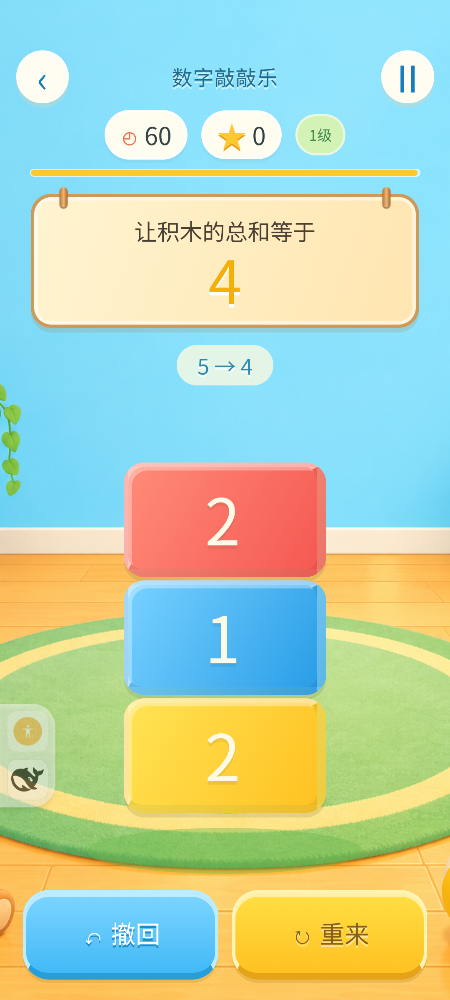
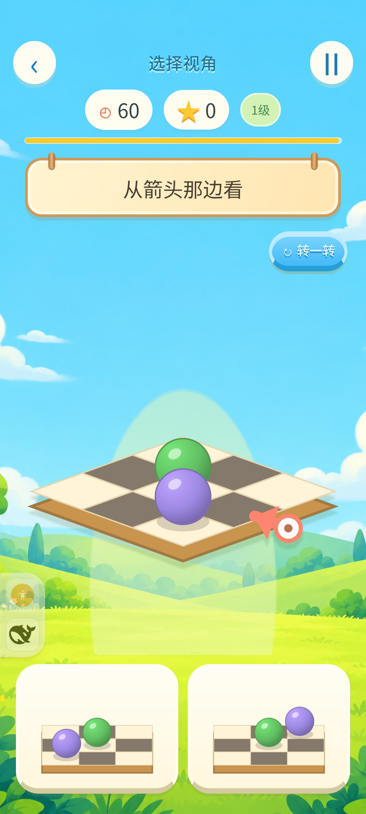

# 游戏中心4.36：音乐、玩家与脑力界面

三项需求均已实装，版本4.36 / versionCode59。原20个入口、脑力20种随机玩法、固定关卡编号及原存档保留。

## 当前使用

- 首页右上角头像进入本地玩家管理：新增、切换、改名、头像和清空所选玩家进度。原数据属于默认“小玩家”；这是设备内档案，没有联网注册或云同步。
- 首页齿轮进入设置：背景音乐和音效各有独立开关、音量滑块；震动与常亮保留。音乐默认22%，原音效开关与70%增益保留，系统媒体音量不变。
- 五首原创合成循环曲按游戏/脑力类别分配，全部离线。录音、专业评测和示范朗读期间暂停背景音乐，所有占用结束才恢复；离页、后台和销毁释放播放器。
- 脑力游乐园实际使用新生成的天空草地、玩具教室背景，统一木牌、暖黄/蓝色按钮、彩色积木和棋盘彩球；题目和操作仍是真实HTML/SVG。

## 验收证据

| 验收 | 结果与记录 |
| --- | --- |
| 项目回归 | `npm test`，589项全部通过，包含真实Java音乐/音效生命周期harness和录音/示范/评测重叠保护 |
| 三尺寸脑力操作 | 20款×320×568/392×872/568×320×1/10级，共120题真实Chrome鼠标计分；0误触、异常和溢出，含记忆隐藏后与照灯候选出现后的布局，见[脑力记录](brain-ui-review.md) |
| 本地玩家 | Chrome实际密码箱存档、30键往返隔离、旧页迟到写入拦截、真实额度写满和注入失败回滚/恢复，见[玩家记录](players-review.md) |
| 音频 | 五首OGG真实Chrome解码、单播放器、音量和重叠暂停通过；谱面/响度/循环边界/哈希可复核，见[音乐记录](music-implementation.md) |
| MIX 4 DEV | 20款逐个实际触摸答对计分、第二题、暂停/继续；五类曲目、Android侧滑暂停→详情→菜单→首页通过，共102次触摸，见[设备结果](phone-review.json) |
| MIX 4声音/档案 | 实际设置滑块分别50%、独立开关、新增两玩家、真实密码箱草稿隔离/切回、具名重置取消/确认、示范按钮、真实麦克风启动、HOME后台停止/前台恢复通过 |
| 存档恢复 | 测试结束回首页，32项localStorage原始值逐键相等，原生音效/震动/两种音量/常亮均恢复；测试玩家与事务日志移除 |
| 安装包 | DEV、正式与源码435项assets逐字节一致，五首OGG均ZIP Stored；同签名覆盖安装，正式设备APK哈希与本机构建一致，正式关闭DEBUGGABLE/CDP，见[安装结果](apk-review.json) |
| 正式包控件 | ADB实体触摸首页玩家入口→安卓返回留在首页；齿轮→设置显示4.36→安卓返回首页。系统AudioPlaybackConfiguration确认本应用MediaPlayer处于started，见同一安装结果 |

真机发现并修复导航清空原生曲目后网页缓存仍认为已选曲的问题：每次恢复/重试都重新确认幂等曲目ID，再请求播放。对应回归检查包含在音乐测试中。设置页原生返回的旧版本号同步修正为4.36。

正式包补验发现首页玩家弹窗的Android返回会被原生首页退出逻辑抢先处理。宿主现在也先询问首页`onRugeBack`，让玩家确认→编辑→列表→首页逐层消费；首页没有弹层时才退出，保留已有generation和页面地址保护。

没有用模拟输入冒充专业发音评测，也没有为本次音乐测试消耗付费评分次数。真实麦克风测试用于检查录音和音乐互斥；语音识别准确率和孩子的主观听感不在本次自动验收结论内。

## 实际画面

| MIX 4菜单 | MIX 4数字积木 | MIX 4视角题 |
| --- | --- | --- |
|  |  |  |

## 素材选择

调研过[Kenney Music Jingles](https://kenney.nl/assets/music-jingles)（该包CC0、以短音效/短乐段为主）、[OpenGameArt的单首益智循环曲](https://opengameart.org/content/sci-fi-puzzle-in-game-1)（该条目CC0），以及[Incompetech官方许可](https://incompetech.com/music/royalty-free/licenses/)（免费方式需署名）。不能把某个站点的所有素材概括成同一许可。

本次实际交付采用五首原创程序作曲/合成，未下载以上曲目，保留完整生成器、音符事件和摘要；无需播放时联网。[场景生成提示词](../../app/assets/brain-school/art/sources.json)、[音乐谱面与来源](../../app/assets/shared/music/manifest.json)、[第三方说明](../../THIRD_PARTY_NOTICES.md)随源码保存。

所有自建浏览器、上下文、临时HTTP服务与本次ADB转发均按finally清理；私有设备快照不进入Git。
