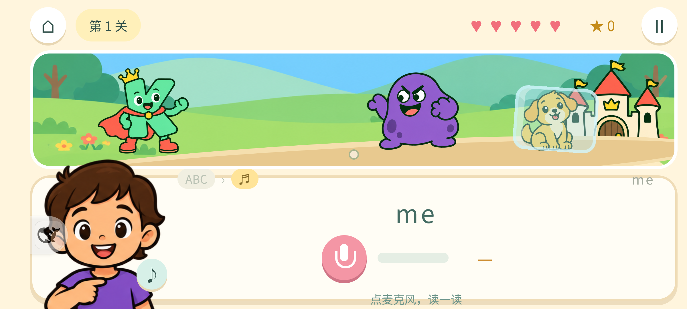
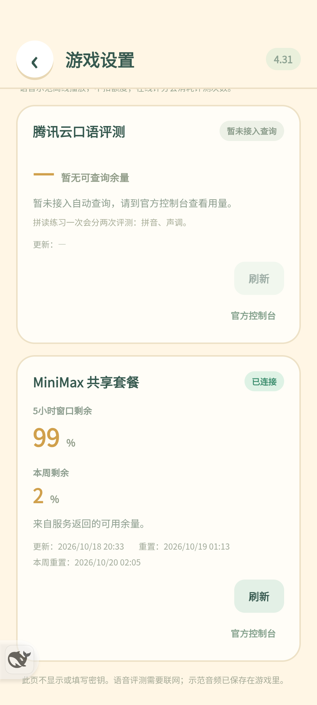

# K国王回家、专业读音与游戏设置 · 4.31

## 本次交付

- **开口读拼音**接通腾讯真实专业评分，原60字/80读法与12个入门拼读保持。整字按指定读音评声调；拼读逐段检查声母、韵母和合读，再独立校验末字真实声调。缺段、错读、声调未确认不能通关；不会把ASR置信度、音量或强制对齐的目标音素后缀当声调分。
- **K国王回家**：横屏20关、37次单词挑战，包含孩子指定9词。先拼写、再读词，答对施法、击退坏队、解冻伙伴并回家。每关5心；网络、无声或损坏评分不扣心；连续5次有效错误只重来本关。独立存档。
- **101条离线示范**：MiniMax生成9条英文、80种中文读法、12条完整拼读。中文示范包含声母呼读音、韵母、合读，多音字按选定读法播放；录音/后台/离开会停止。播放不联网、不继续扣订阅额度。
- **游戏设置**：首页右侧一个齿轮，原音效、震动、常亮集中到设置页；固定标题、内容可滚动。网络服务统一卡片，可扩展后续提供者。
- **服务余量**：MiniMax实际查询5小时/周共享套餐的剩余百分比和重置时间。腾讯评测配置已生效，但余量暂未接入自动查询，显示未知并可打开官方控制台。没有用1万减本机调用量伪装账户余额。

## 美术

先用内置GPT图片生成原型，再生成K国王、坏队、伙伴、城堡、9词图集和场景。采用扁平、明快、粗线条的原创儿童画风；按实际透明主体边界等比显示，避免王冠裁切、邻格碎片或角色拉宽。首页封面来自真实游戏封面页。

[原型](English/prototype.png) · [完整提示词](English/imagegen-prompts.json) · [原图位置与SHA](English/generated-art.json) · [英语玩法与四尺寸截图](English/review.md) · [示范音频文本、音色与SHA](Demo%20TTS/source.json)

## 验证

- [全项目441项回归](tests.txt)全部通过。包含实际Java签名/前台权限/队列取消、双阶段评测、真实空握手、最终无效分拒绝、五心、迟到评分、示范取消与设置余量解析。
- [英语真实Chrome](English/browser-qa.json)：四种横屏尺寸，20关37词逐个真实DOM拼写、模拟评分、施法、继续、下一关通过；五错重试与后台恢复通过，0 JS错误。浏览器分数是明确夹具，不能称为真实儿童评分。
- [专业云对照](Speech/protocol-notes.md)：50次本机合成音直传。英文九词正负例分离；MiniMax班拼读86分、山92分、班整字86分且真实Tone通过；错调/漏读/无声负例拒绝。早期macOS合成声一声缺少有效Tone，没有为此放宽判定。
- [MIX 4真实输入链](device-qa.json)：实体触摸进入英语、拼字提交、播放包内示范；开始录音会停止示范；后台停麦、恢复明确继续、系统返回回合集。中文完整示范与暂停停止也通过。
- 手机扬声器→实际麦克风→腾讯云→实际UI：[英文me 94分并施法](device-english-live.json)、[中文“这”93分且声调匹配](device-chinese-read-live.json)。中文多段扬声器回录被回声处理漏段而拒绝，未降低判题条件；完整多段直接音频云对照已通过。以上合成输入证明链路，不代表儿童口音、发音教学质量或家庭噪声准确率已验收。
- [设置真机](device-settings-qa.json)：三个开关切换并恢复；MiniMax由手机原生实时取得5小时99%/本周2%快照；30秒冷却、离开设置后桥返回空服务列表，设置页不能调用录音能力。余额是当时快照，以刷新后的服务返回为准。
- [设置Chrome](Settings/review.md)：320×568、392×872、872×392布局、标题冻结、异步刷新与窗口到期本地失效通过，0 JS错误。
- [101条示范校验](Demo%20TTS/verification.json)：SHA、解码、32kHz单声道、任务覆盖全部通过。共102次生成请求，含1次频率限制后按窗口等待并节流恢复，没有额度耗尽错误。

## 安全与交付

云凭证只在本机私有配置与AndroidKeyStore加密配置；不在JS、APK或Git，不记录签名URL/家庭录音。余量查询在原生固定HTTPS端点进行，只授权包内设置页，禁止重定向、限时、限量、限频并随后台取消。设置页不显示/填写密钥。

[服务查询依据及限制](Services/provider-quota.md)：腾讯官方CAM存在控制台资源包动作，但无本轮可验证的公开请求版本/参数契约，未查询泛账户账单或其他产品资源。MiniMax“次数”字段为0时按实际百分比呈现，不能误显示为可调用0次。

[存档恢复](save-restore.json)：27项原localStorage和原生偏好精确恢复，等待6秒复读一致。测试新记录移除，评测与MiniMax配置保留；同包名/原签名覆盖安装正式4.31/54，没有卸载或清数据。[最终包核对](release-verification.json)。

