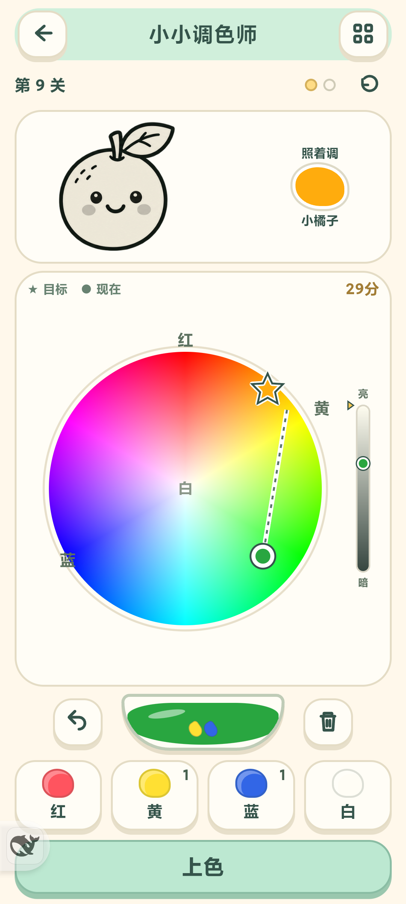
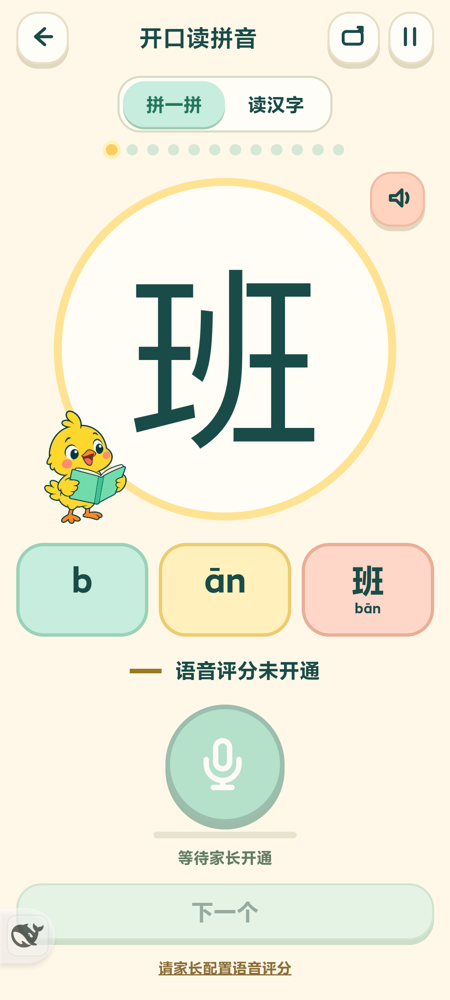

# 游戏中心 4.30：调色、中文语音与英语选题

## 交付范围

| 内容 | 本轮状态 |
|---|---|
| 小小调色师 | GPT生成原型及角色素材；新版连续大色盘已实现，保留原混色、14个目标和存档 |
| 开口读拼音 | GPT生成原型和小鸟素材；界面、专业评测桥及结果判定完成。用户尚未开通服务，保持待配置、不录音、不显示模拟分 |
| K主角英语游戏 | 4个方向调研完成，尚未实现，等用户选择 |

## 小小调色师

普通连续色盘取代离散色点。目标星、当前圆点、最近轨迹与亮度条保留；加黄/蓝改变色相，加白向中心移动并变亮。连续色盘是实际RYB混色结果的HSV位置显示，不改变颜料混色、配方、过关距离或存档。

- [生成原型](Paint/paint-ui-prototype.png)、[实际角色图集](../../app/assets/paint-mixing/art/paint-friends.png)
- [提示词](Paint/imagegen-prompts.json)、[来源/哈希/裁切](Paint/generated-art.json)
- [四尺寸浏览器与14目标验收](Paint/review.md)

美术使用内置image_gen生成，透明图集原样保留、等比裁切；色盘本身由连续颜色数值绘制，保证标记与颜色一致。

## 开口读拼音

原“看字打拼音”菜单增加独立入口。默认“班”的拼一拼，也可切换读汉字。

- **读汉字：** 复用原6组60字、80种接受读法，多音字选择目标读法。
- **拼一拼：** 12个入门字：班、山、大、人、好、三、上、下、天、地、来、小。例：b → ān → 班；三拼音分开显示。新入门词表不修改原键盘字库。
- 原型强调大字、大拼音卡、大麦克风和本次反馈；支持横竖屏。默认未开通，显示“等待家长开通”，麦克风和下一字禁用。
- 接通服务后每次取专业服务真实总分和片段分；首版门槛80、各片段至少60，并要求必需声调结果有效且正确。漏读、只读整字、错调、未确认调或多读不能过关。失败保留当前题和本次分数。
- 轻声不支持拼音模式8，走整字模式0，不伪造独立声调分。多音字非默认读法及轻声暂禁系统单字示范，防止TTS误教。
- 语音进度`rugeHanziReadingV1`独立，原键盘成绩和字库保持。只保存字、读法、模式、真实最高分与是否通过，不保存音频、云密钥或签名URL。

[生成原型](Reading/reading-prototype.png) · [实际小鸟素材](../../app/assets/hanzi-typing/art/reading-bird.png) · [提示词](Reading/imagegen-prompts.json) · [四尺寸界面验收](Reading/UI/review.md)

### 专业评测接入

选用腾讯云智聆口语评测新版的协议适配。官方明确支持拼音的声母、韵母和合读，以及声调检测；代码使用固定WSS地址、录音模式、16k单声道PCM。云密钥由AndroidKeyStore加密保存在应用私有配置中，原生签名，页面只拿短期URL。没有新增第三方jar或so。详见[原生契约及后续配置](Reading/native-assessment.md)。

用户已明确“还没开通，先把界面和接入代码做好”。所以**本版不能实际给孩子评分**：没有配置真实账号，没有发出云评测请求，没有真实服务结果或儿童评分准确率验收。协议与UI测试使用明确标注的合成夹具，不进入产品默认状态。

后续开通步骤：在腾讯云开通对应评测服务，将AppID、SecretID、SecretKey填入本机不纳入Git的`.local-voice/tencent-assessment.env`；由维护者在DEV前台朗读页配置后覆盖同签名正式包。密钥不发聊天、不放assets或仓库。开通后先验证正确/错声母/错韵母/错声调/漏读/噪声，以及孤立声母和多音字，再调整儿童门槛。

参考：[新版WSS接口](https://cloud.tencent.com/document/product/1774/107497)、[拼音说明](https://cloud.tencent.com/document/product/884/78883)。页面只允许连接腾讯评测WSS，其他游戏资源仍离线读取，禁止明文网络与远程脚本。

## 英语：推荐K的单词魔法岛

|方向|核心循环|
|---|---|
|**K的单词魔法岛（推荐）**|看图读cat/sun，K放出猫爪/阳光魔法击退软糖怪；每3词一个小首领|
|K的拼读机甲|组合声音积木，连读单词后机甲发动；更偏自然拼读|
|K的口令救援|读jump/stop/open，让K越障救伙伴；和已有口令游戏重合较多|
|K的变身对决|看敌人弱点，选道具再读词，K变身解除障碍；更动脑|

K是主角，不把所有词限制为K开头。字母名/keɪ/与常见字母音/k/要分开教。参考Teach Your Monster及Duolingo ABC的分步结构，先看图认词再逐步隐藏文字。完整方案与来源见[英语选题调研](English/K-game-research.md)。尚未生成英语美术或开发玩法。

## 验证与交付证据

- [全项目407项测试](tests.txt)通过，原键盘与调色回归保留。
- 新专业测评签名/权限/队列测试执行真实Java辅助函数与桥接代码，包含独立Python HMAC对照和排队取消负例。协议测试拒绝中间高分冒充最终评分、旧会话、无声与错误结果。
- 两款UI各4种尺寸真实Chrome检查；调色14目标实际点击通过。截图中的`SIMULATION-*`仅是测试夹具状态，不能当真云评分。
- [MIX 4验收](device-qa.json)：调色连续盘、加白/撤销；旧打字入口、新语音未配置路径、两种练习、转屏、后台暂停、系统返回。没有真实云评测。
- [存档恢复](save-restore.json)、[正式包核对](release-verification.json)。测试前数据与原生偏好逐值恢复，安装使用同签名覆盖，没有卸载或清数据。

