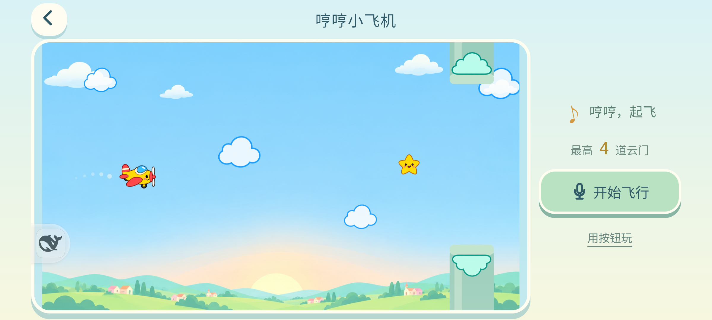
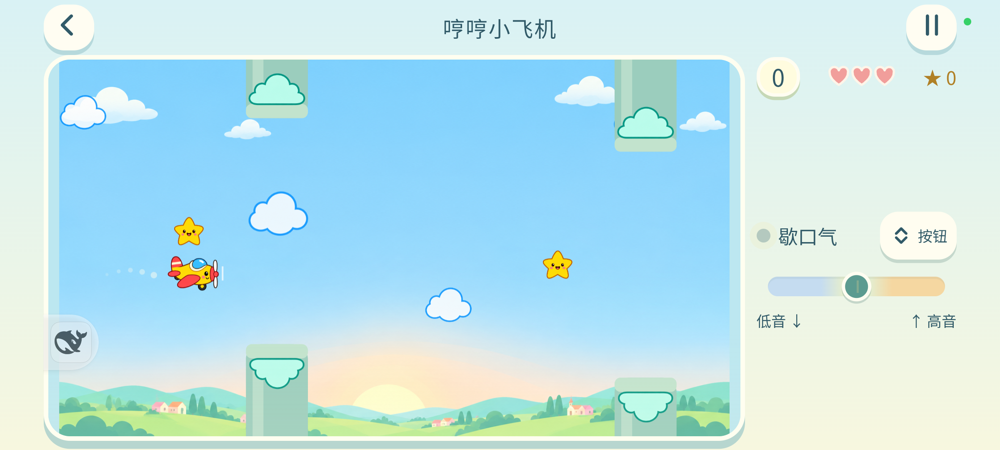

# 哼哼小飞机 · 4.29

## 本轮改动

- “唱跳小兔”改为固定横屏的无限横版飞行，返回合集恢复竖屏。默认声音开始，短哼校准后持续高音上升、低音下降、中音/静音保持高度；不再一次叫声只触发一个动作。
- 前两道宽门练习，第3/4/5道引导上/下/上。之后种子随机路线、速度和门宽渐难并封顶，收星星、三颗心、受伤短保护。碰同一道门不会反复扣心。
- 按住大按钮是备用控制。暂停/后台停止收音，回来明确继续；重开复用本次已校准音域。新纪录独立保存，旧唱跳关卡和跑酷存档保留。

## 美术与参考

使用内置 **image_gen** 生成，未使用CLI替代。黄色小飞机四帧、云朵、云帽、星星、爱心与天空已放入离线包：

- [飞机与道具图集](../../app/assets/pitch-adventure/art/flight-sprites.png)
- [天空背景](../../app/assets/pitch-adventure/art/flight-sky.png)
- [完整提示词集](imagegen-prompts.json)、[素材哈希及裁切坐标](generated-art.json)
- [同类玩法参考与儿童化处理](research.md)：Voice Flappy、Sing & Fly、Glide。仅参考机制，没有提取对方代码或美术。

透明图原样保留，以真实主体边界裁切并等比绘制，避免邻格碎片与拉伸。封面由实际页面生成。

## 验证

- 全项目 **382/382** 测试通过，见[完整测试](tests.txt)。旧玩法回归只切换到保存的legacy入口，未删断言。
- 新核心/输入/界面及旧声音回归 **61/61**；32种子各120道门无伤、20种子各20门每半秒粗调无伤；100种子静音挂机均在第5门结束。
- [真实Chrome验收](QA/review.md)：4种横屏尺寸，无溢出及Canvas异常；中音和静音挂机对照均结束，半秒调整一次音高可通过20门，3心完整。
- [MIX 4验收](device-qa.json)：进入自动横屏、Android返回恢复竖屏；手机扬声器合成音进入真实麦克风，验证持续高/低音、换气保持与后台停麦。此项验证完整输入链路，不代表儿童人声识别率或主观乐趣已验收。最终规则另用实际RAF静音运行验证，不能挂中间一直过门。
- [存档恢复](save-restore.json)：原27项localStorage逐值还原及删除测试新键，原生声音/震动/常亮偏好精确恢复，等待6秒复查。
- [正式包核对](release-verification.json)：源码、DEV与正式包276项assets一致；2个原有原生库未变，正式包覆盖安装后核对版本、APK哈希及调试接口关闭。没有卸载或清数据。

Android CDP截图偶尔漏掉硬件加速Canvas；本轮手机美术证据使用ADB系统截图，不能把该截图工具问题当成游戏白屏。

## 试玩关注

给孩子实际试一下舒适音域、连续发声疲劳和第3道开始的升降节奏。自动策略证明可达，不证明五岁儿童一定好玩。停声后音频缓冲与平滑跟随有短暂收尾，随后保持高度。
