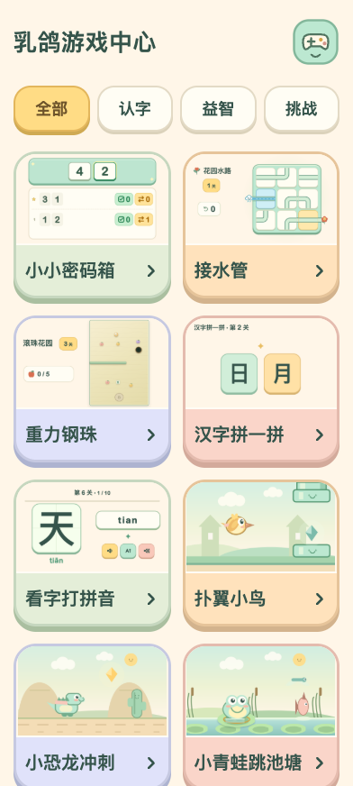
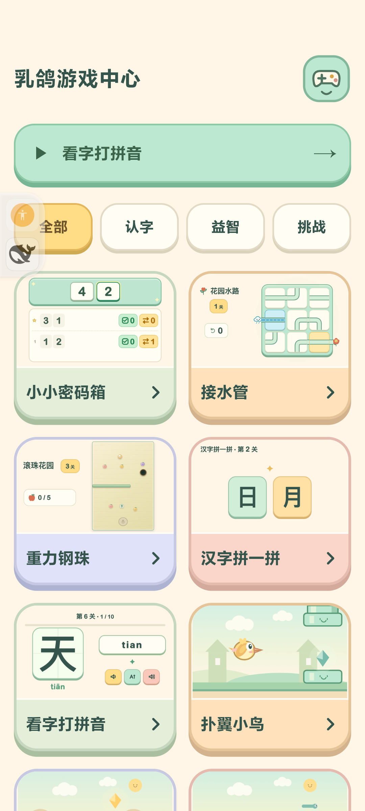

# 游戏中心全游戏儿童界面验收

日期：2026-10-12。版本：4.5 / versionCode 28。设备：小米 MIX 4，Android 14。

## 本轮修改

用户要求把已认可的小小密码箱风格应用到其他全部游戏。八款游戏与合集采用奶油底、薄荷绿/暖黄/浅粉、大字、大按钮、圆润卡片和短阴影。删除常驻说明段落、英文副标题与冗长结算文案；保留题目、必要数字、清楚图标与少量动作词。

| 游戏 | 修改与核验 |
|---|---|
| 小小密码箱 | 保留 4.4 已认可的大数字/三列键盘与绿勾、黄换位反馈；纳入新合集入口 |
| 接水管 / 花园水路 | 放大关卡和撤销/提示/重试；玩具管道、云朵水源和笑脸花朵；修复刷新误覆盖端点图案；增加暂停 |
| 重力钢珠 / 滚珠花园 | 大水果数量/心形生命；大倾斜/触摸选择；笑脸球与水果，黑洞仍清楚；暂停页可切触摸继续 |
| 汉字拼一拼 | 大部件、大完成汉字；图标返回/重来；去掉字理、收藏和操作说明 |
| 看字打拼音 | 大题字、大输入框；朗读/拼音/声音 SVG 按钮；选关和结算精简；输入法出现时收起次要工具 |
| 扑翼小鸟 | 大开始/练习/继续；大目标数量；鸟、笑脸水管和太阳统一柔和画风 |
| 小恐龙冲刺 | 大开始/继续/重玩；大目标数量；圆润恐龙、笑脸仙人掌和太阳 |
| 小青蛙跳池塘 | 大开始/继续/重玩；大目标数量；圆润青蛙与池塘角色；保留点按和二段跳 |

合集只保留分类、游戏名、实际封面和入口箭头。八张封面通过 `scripts/render-game-covers.py` 从真实 `?cover=1` 页面生成，角色与运行中的绘制一致，封面模式不写存档。



## 验证结果

- `npm test`：**57 / 57 通过**，涵盖规则、暂停、存档恢复、关卡可解性、重复部件、动作碰撞和拼音计分。VM 不判断像素或真实音频。
- 浏览器：392×872 与 320×568 检查合集及七款重做游戏，未发现横向溢出；游戏主要按钮可见，无页面脚本异常。合集允许纵向滚动。截图文件为 `browser-<game>-<width>.png`。
- 真机：水管实际触摸旋转、撤销、提示、暂停/继续；重力实际触摸移动、暂停/继续；汉字实际点击合成“林”与下一关；三款动作游戏实际开始、触摸、暂停/继续。对应截图为 `phone-*.png`，状态证据见 [phone-checks.json](phone-checks.json)。
- 真机侧滑：水管、重力、汉字、三款动作和密码箱回合集。拼音先收起输入法再退出属于系统惯例，本轮没有把键盘关闭计作回合集验证。
- 拼音首次输入法弹出时，可视高度 557.09px，输入框底边 495.09px，完整在键盘上方；计分通过 CDP 提交文本验证，正确数量 0→1，暂停/继续通过。ADB 英文按键未成功提交到当前输入法，因此没有把它记作真实英文键盘逐键验收；本轮也未确认实际朗读声音。`phone-typing-play.png` 展示键盘收起后的题字与输入，不作为键盘弹出截图。
- 测试前保存全部 localStorage；测试后回合集、等待页面退出保存，再精确恢复全部 **12 个原有键和值**，删除测试新键。随后覆盖安装正式版，未卸载、清数据或改安全设置。

## 正式版安装

`out/game-center-v4.5.apk` 已用原证书签名并覆盖安装。手机实际 versionName=4.5、versionCode=28；已启动并停在合集。安装包与本地 APK 的 SHA-256 相同：

```text
45994d4f5dd316750c8d0e0156362d42b24ca086d0ef9de97247d4078bd28d40
```

正式版关闭 WebView 调试，无当前会话游戏崩溃记录。签名、对齐、离线权限与资源内容由构建脚本校验；记录见 `out/game-center-v4.5.json` 与 [formal-install.json](formal-install.json)。



本轮是界面与美术调整，没有重新设计全套关卡或更改动作物理难度。重力四方向传感器的完整实测沿用既有记录，本轮重点验证触摸与新暂停入口。源码与验收材料由 Mac 统一提交到 main。

自有浏览器、HTTP 服务和 ADB 转发均已关闭/清理；临时查询和存档备份在验收结束后删除。
