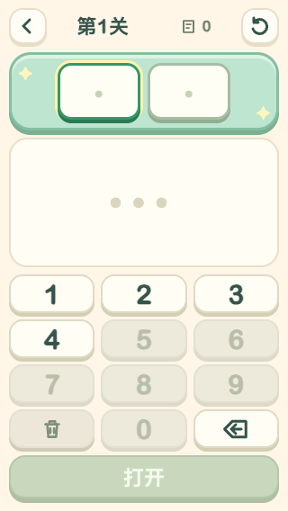
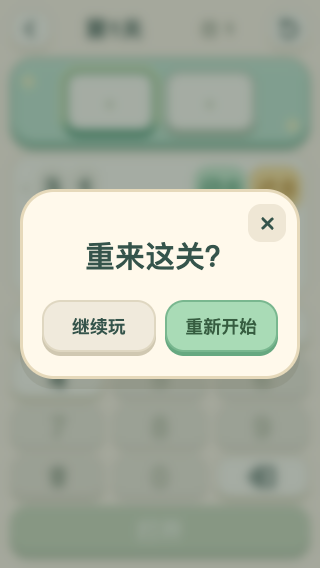

# 小小密码箱：空白开局、亮色退格与本关重置

日期：2026-10-16。版本：4.7 / versionCode 30。设备：小米 MIX 4。

- 18 个固定关卡均移除预填起始猜测，历史只展示玩家实际提交的记录；以前预填过的数字也允许成为第一次猜测。固定答案和已有星数不变，旧存档的真实猜测继续恢复。
- 退格改为与数字键相同的亮底深色，放大向左箭头图标；从空输入格按退格时向前一格擦除，连续按逐格删除。清空全部仍是独立的垃圾桶按钮。
- 顶部右侧增加重置按钮，本局有内容时提供“继续玩 / 重新开始”确认。重置保留当前密码、关卡、难度及已获星数，清空本局猜测、草稿、次数、提示和结束状态。暂停期间不可重置。

## 验证

- 全套 **63 / 63** 测试通过，见 [tests.txt](tests.txt)，覆盖全部关卡空白起点、旧存档兼容、逐格退格、重置取消/确认/保存及自由挑战设置保留。
- 浏览器 392×872 / 320×568 无横向溢出；小屏提交按钮底边 554px，顶部重置可见。退格与可用数字键计算样式一致：底色 `rgb(255,253,244)`，前景 `rgb(53,84,75)`，无脚本异常。
- MIX 4 验证全部 18 关无预填记录、实际输入“31”作为第 1 次猜测、顶部重置确认/取消/保存恢复、四位输入连续退格。10 项真机检查通过，见 [phone-checks.json](phone-checks.json)。
- 测试后回合集等待页面退出保存，精确恢复原有全部 12 项 localStorage，再用原签名覆盖安装正式版；未卸载或清数据。
- 已安装正式版 **4.7 / 30** 并启动；安装包 SHA-256 与本地 APK 一致，WebView 调试关闭，见 [formal-install.json](formal-install.json)。

自有浏览器、HTTP 服务、临时备份与 ADB 转发在验收结束后清理。
