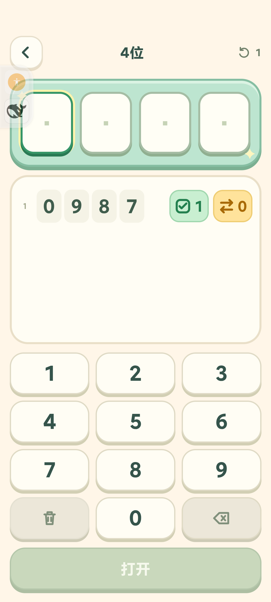

# 小小密码箱：零可放在第一位

2026-10-12，游戏中心 4.6 / versionCode 29。

用户确认密码是数字序列，0 和其他数字一样可放任意位置，仍要求数字不重复。已删除规则校验、候选生成、键盘禁用、输入处理和草稿恢复中的首位零限制。密码与猜测持续使用字符串，`01`、`012`、`0123` 不转为整数、不丢位数。

随机密码现在覆盖全部 10P2=90、10P3=720、10P4=5040 种序列。固定关卡数字池与答案保持原值，更新关于零的关卡描述；原有未完成关卡、已获星数和 schema 1 存档继续兼容。

## 验证

- 全套 **59/59** 测试通过，结果见 [tests.txt](tests.txt)。包含零开头输入、反馈、候选全集、随机抽样、草稿/历史/答案重载和胜利不重复计分。
- MIX 4 真机分别用真实点按完成 2、3、4 位零开头猜测（09、098、0987）、反馈检查、零开头草稿重载，以及零开头答案（01、012、0123）通关与胜利存档重载。为稳定复现，将测试随机源临时设为 0，调用真实随机生成逻辑后立即还原。
- 测试后回合集等待页面退出保存，精确恢复测试前全部 12 项 localStorage；未卸载或清数据。真机状态见 [phone-checks.json](phone-checks.json)。
- 原签名覆盖安装正式版 4.6 / 29，启动与包校验见 [formal-install.json](formal-install.json)。正式版 WebView 调试关闭。临时备份和脚本已清理。源码与验收材料统一提交到 main。

