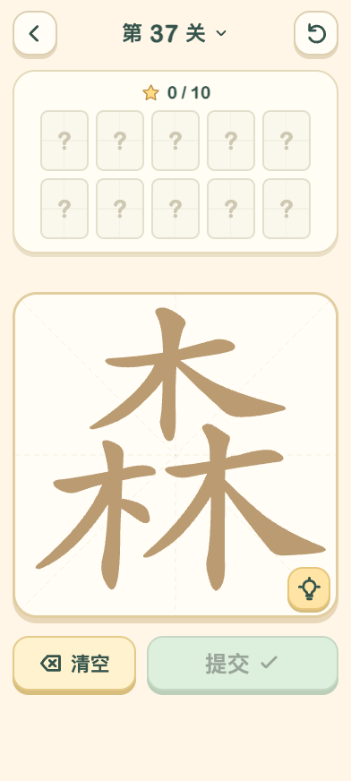
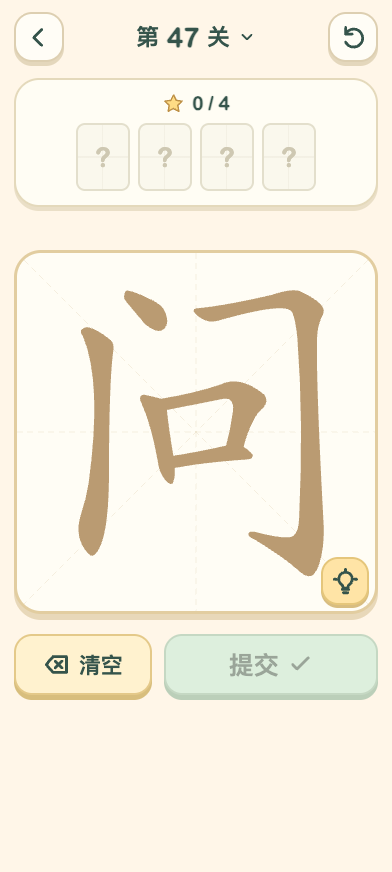

# 字里找字：单画布嵌字（4.12）

## 设计与实现

按用户要求搜索、实际查看 [《汉字找茬王》口口男关卡截图](https://www.9game.cn/hzzcw/8439055.html)，确认大画布中的包围、上下与左右嵌合关系。参考说明见 [references.md](references.md)，参考截图不作为本项目素材。

原先30个多字题改为真实合体字的单张 SVG 大画布，取消每个源字的小卡片、边界和分隔线：

- 森、晶、品、众是紧凑品字结构。
- 问、间、闲由门包围内部部件。
- 泉、李、思、音、早等呈上下结构。
- 明、林、妈、好、她、相、晴等呈左右结构。

使用固定提交的真实字形笔画，适当采用偏旁写法（如女旁末笔为提、林左木末笔为点），没有简单把独立全字缩小拼贴。30份合体几何的笔序逐部件审查，原全局选择索引保持；规则层仍是60关、344答案、同一存档schema。各源字原有候选和允许的跨部件组合不变。

`board-geometry.js` 提供当前完整字形和命中中线，交叉处按最近中线选笔；所有365笔均有可命中位置，不存在完全被其他字盖住而永远点不到的笔画。

## 验证

- 全套 **95/95** 测试通过，新增7项覆盖嵌套、几何映射、每笔可达和旧索引存档：[tests.txt](tests.txt)。
- 浏览器对真实新画布执行 **1096次笔画点击、344次答案提交**，完成全部60关；392×872、320×568、872×392 检查明、森、问、晴的单画布和主要按钮，无页面异常：[browser-checks.json](browser-checks.json)。
- MIX 4 **17/17** 真机检查通过，详见 [phone-checks.json](phone-checks.json)：在明、森、妈、问、晴的新几何中实际逐笔提交全部候选；独立选中门内口、旧三字草稿恢复、后台暂停及系统侧滑返回。测试草稿和解锁为规则API准备，真实点击步骤使用ADB触摸。未将这些准备操作记为玩家进度。
- 测试结束还原全部原localStorage键和值，再覆盖安装正式版4.12/35，未卸载或清数据。最终安装包校验见 [formal-install.json](formal-install.json)。

## 来源与范围

73份固定提交来源记录保存在 `sources.json`；30个合体字中29个新增几何，早复用原有数据，遵循 Arphic Public License。原44个源字数据与60关内容未改。入口封面从真实明字关的cover页面重新生成，cover模式不写存档。

所有临时浏览器、服务器、参考截图和存档快照在验收后清理。源码未提交或推送。

正式 APK SHA-256：`bfbd913f3cfb6fe1f9b25c5aaf330de440c120f880941287198abf3955080201`。
