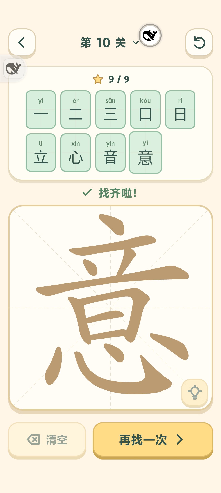

# 字里找字：改名与原字答案（4.9）

## 修改

- 入口、页面标题、选关标题、实际封面统一改名为 **字里找字**。
- 每关原字本身也作为答案，必须选择全部完整笔画后提交，不自动赠送。三的答案为一、二、三；王可以提交王；意也可以提交意。
- 10 关共 60 个答案。保留同一答案不同合法笔画选法，重复收集不计数。
- 沿用现有存档键；旧答案、草稿和已解锁关卡保留。旧关卡若缺新增原字，显示待收集原字，不清空其他答案或回锁后续关卡。
- 9 个答案在竖屏采用五列两行，提交按钮保留可见。

## 验证

- 全套 **84 / 84** 项测试通过，见 [测试输出](tests.txt)。包括所有原字的全笔画匹配、十关通关和旧进度兼容。
- MIX 4 真实点按三、王、意的全部笔画并提交，三个原字均收进顶部；意达到 9/9。确认名称、旧 50 个答案与解锁记录保留、新答案重载恢复，见 [手机检查](phone-checks.json) 和截图。
- 手机 CDP 尝试模拟 320×568 时 WebView 仍返回实际 392×872，该次检查无法用于小屏结论，原记录保留。随后使用桌面 Playwright 在真实 320×568、392×872 视口检查九个答案格和提交按钮，均无横向溢出且按钮完整可见，见 [布局结果](browser-layout.txt)。
- 测试后精确恢复全部 **14 项原 localStorage 键和值**，再覆盖安装正式版 **4.9 / versionCode 32**。未卸载、未清数据、未提交推送。
- 设备安装包哈希与本地一致，正式版 WebView 调试已关闭，见 [安装核验](formal-install.json)。

APK SHA-256：`fa7d6b57b9d4304c4f2f9832913149edecbb52fe267447dea4f69c7158c93ff2`。

