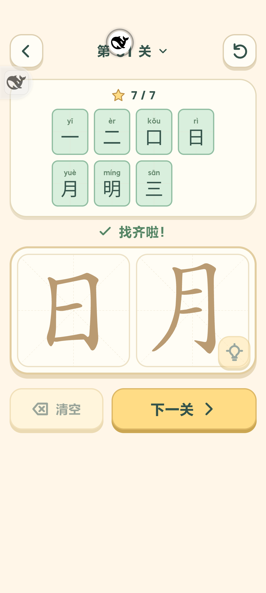
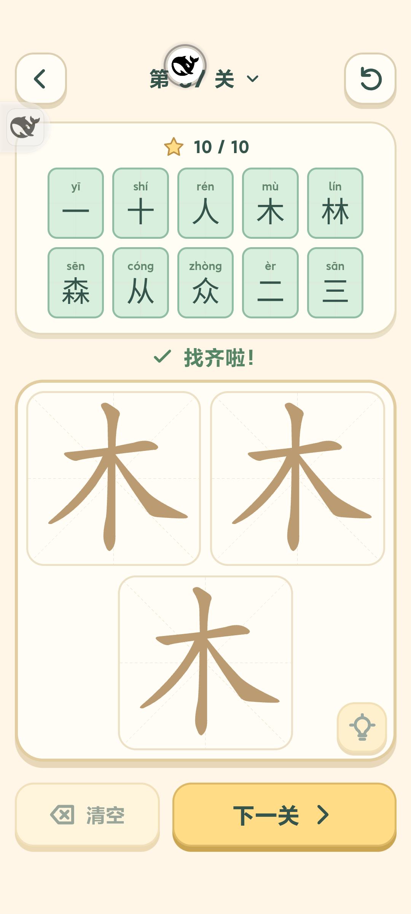

# 字里找字新增 50 关（4.11）

已覆盖安装 MIX 4 正式版 **4.11 / versionCode 34**。原有 10 关顺序和答案保留，新增 20 单字、26 双字、4 三字题，总计 **60 关 / 344 个关内答案**，每关 **2～11 个**，均未超过 20 个。最终清单见 [levels.json](levels.json)，来源与人工内容审校见 [内容说明](levels-content.md)。

## 规则和界面

- 原字本身仍算答案。多字题可跨字板选择完整部件、按目标字结构组合，不拆笔、不旋转；如日月→明、田心→思、木木木→森、口口口→品、日日日→晶、人人人→众。完整横画也可跨字板组成二、三。
- 合并同字合法选法，同答案只收一次。按明确常见目标设计，并非任意笔画穷举识字。同一选集无法区别结构的字只收一个，例如木口收杏，不同时收呆。
- 每个字有独立 SVG 和局部中线命中，索引按关内偏移保存。三字为两上一下，答案超过10个在答案区内部滚动；选关仅滚动网格，关闭按钮固定可见。
- 沿用 rugeHanziStrokesV1 / schema 1，补齐新关空进度，保留旧答案/草稿/解锁记录。旧十关已完成时自动解锁第十一关。测试后精确恢复原14项localStorage再覆盖安装，未卸载或清数据。

## 验证

- **88/88** 回归通过：[测试结果](tests.txt)。包含选集判定、60关全通、原字答案、跨字横画与旧存档。
- 浏览器实际 **1096次笔画点击、344次答案提交**完成全部60关；320×568、392×872、872×392 检查双字/三字/最大答案关布局，后段选关和关闭按钮可见：[浏览器结果](browser-checks.json)。
- MIX 4 **14/14** 检查通过。实际点按完成第11/31/37/60关全部答案，验证重复答案、三字横画、草稿重载、选关、后台暂停与侧滑返回。其他关卡通过真实规则API准备解锁状态，不称作手动通关：[手机记录](phone-checks.json)。
- 正式APK哈希与本地一致，调试socket关闭，当前进程未见崩溃：[安装核验](formal-install.json)。哈希 `f89f5dca9fa0e4d6d2098de648ab0f3bbce191d276560cc8380488fe32fbc7b5`。

44字原始笔画固定到 Hanzi Writer Data 提交，许可与逐文件校验见 sources.json / THIRD_PARTY_NOTICES.md，全部离线打包。已关闭本轮浏览器/服务器并清理临时原始数据、脚本与存档快照。源码未提交推送。

