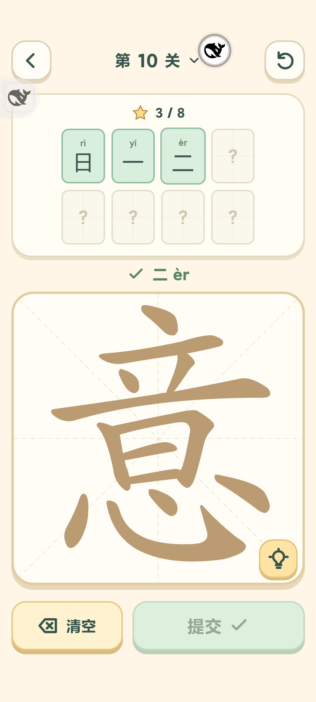
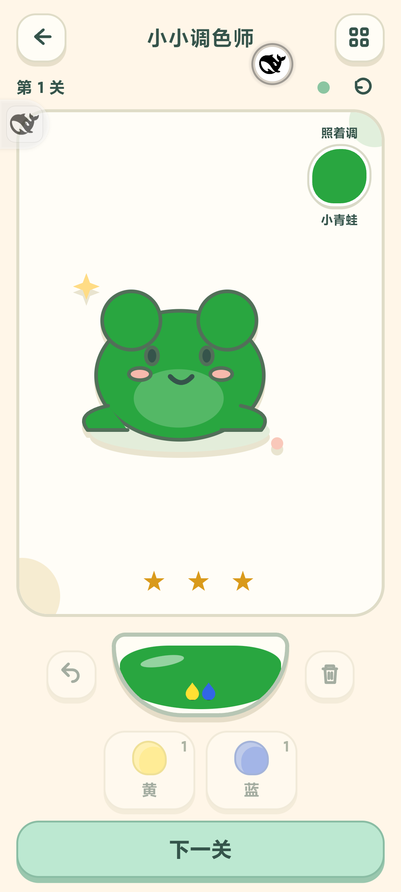

# 游戏中心 4.8：汉字找字与小小调色师

## 交付

已覆盖安装到 MIX 4（Android 14）：正式版 **4.8 / versionCode 31**，同包名、同签名。原有 12 项 localStorage 键和值在测试结束后精确恢复；两款新游戏从空进度开始。没有卸载或清数据。本次源码保留在本地，未提交或推送。

## 汉字拼一拼

实际进入手机“我要当学霸”，在“意”字关卡点选日的四笔并提交，确认答案会收进顶部、原字笔画可再次使用。新版采用这一交互方式重新实现，没有提取参考游戏代码或素材。

| 关卡 | 原字 | 答案 |
|---|---|---|
| 1 | 三 | 一、二 |
| 2 | 王 | 一、二、三、十、工、土、干 |
| 3 | 木 | 一、十、人 |
| 4 | 田 | 一、二、口、日、十 |
| 5 | 白 | 一、二、口、日 |
| 6 | 本 | 一、二、十、人、木 |
| 7 | 目 | 一、二、三、口、日 |
| 8 | 米 | 一、十、人、木 |
| 9 | 早 | 一、二、三、十、口、日、干 |
| 10 | 意 | 一、二、三、口、日、立、心、音 |

10 关共 50 个关内答案。同一答案的不同合法笔画组合均可接受，不重复计数；保持整笔、不移动、不旋转。上方答案格带拼音，下方为大字笔画板。点选、反选、清空、提示、重来、关卡选择和进度保存均已实现。

字形来源 [Hanzi Writer Data](https://github.com/chanind/hanzi-writer-data/tree/68d10a4b21150cae5e1ebbd223eed289cf32d90c)，固定数据和逐文件校验见 `app/assets/hanzi-puzzle/sources.json`，遵循 Arphic Public License。新版使用独立键 `rugeHanziStrokesV1`，保留旧拼部件存档。

## 小小调色师

10 关、14 个订单，加自由画室。先从黄蓝调绿、红黄调橙、红蓝调紫开始，再加入比例变化、加白和连续订单。调好的颜色直接画到原创青蛙、小兔、花朵等图案上；可以撤回一滴、倒掉、重新挑战。

使用原创实现的 RYB 色立方插值和加白近似，参考 [RYB 颜色模型论文](https://cfcs.pku.edu.cn/baoquan/docs/20180621150627775765.pdf)。它是颜料混合的儿童教学近似，不是光学加色，也不能精确预测具体品牌颜料。此次选择颜料玩法，未包含镜面反射光线关卡。

## 验证

- 全套 **83 / 83** 项测试通过，见 [测试输出](tests.txt)。
- 浏览器真实点击全部 50 个汉字答案、14 个调色订单；320×568 和 392×872 无横向溢出，主要操作可见，见 [浏览器检查](browser-checks.json)。
- MIX 4 **45 / 45** 项检查通过：完整笔画触摸、反选、重复答案、意的 8 个答案、保存恢复；调色错误反馈、比例、加白、连续订单、撤回/清空；两款游戏切后台保持草稿并暂停、Android 侧滑回合集。见 [真机记录](phone-checks.json)。中间关卡的真机解锁使用真实规则 API 准备状态，未声称每个中间关卡均在手机手动完整通关。
- 最终安装 [核验记录](formal-install.json)：设备 APK 与本地正式包 SHA-256 完全相同；当前进程未见崩溃，前台为游戏中心，WebView 调试 socket 已关闭。
- APK SHA-256：`d1be90b37eaca67f09a4188d978a0490a2df0d1499c012a5530cffb9622f313b`。
- 真机截图中的鲸鱼悬浮按钮来自手机上已有的 DeepCode，不是本游戏 UI。

封面均从本项目真实 cover 页面生成，封面模式不改存档。原有其他游戏逻辑未在本轮重新逐个试玩，继续由回归测试覆盖。已清理本轮浏览器、临时服务器与临时文件。
