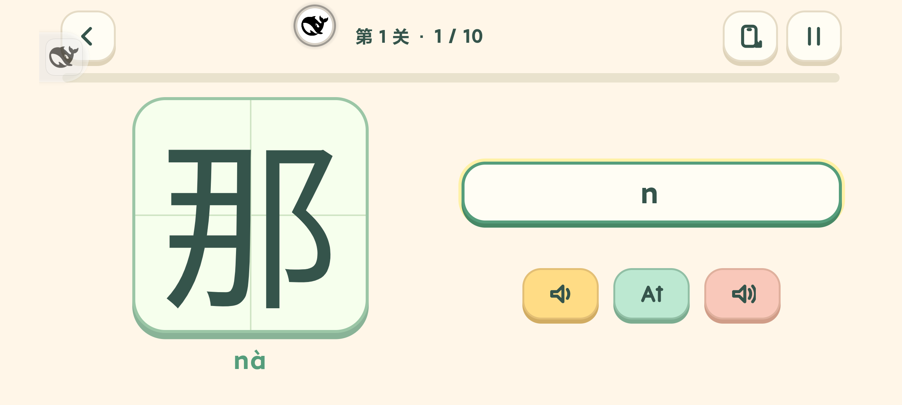

# 看字打拼音：切屏与横屏大字（4.10）

- 选关页底部、练习页右上角增加手机旋转 SVG 图标，可横竖切换；无障碍文案随实际方向变化。
- 调用已有原生 `RugeScreen.set/get`，保持当前题目、分数和拼音草稿；退出回合集恢复竖屏。
- 用户主要横屏连接实体键盘玩。横屏字板随可用高度放大，MIX 4 872×392 实测字板约 229px，题字 computed font-size 约 177px（受系统字体缩放影响）；保留右侧大输入框。此前短屏字板为 105px。
- 拼音模块 8/8 项回归通过，见 [测试记录](tests.txt)。真实原生桥仍以真机测试为准。
- MIX 4 真实触摸验证选关页/练习页横竖切换、题目/分数/草稿不变、输入框及图标可见、横屏大字和退出回合集。见 [真机记录](phone-checks.json)。
- 测试时实际调出手机软键盘；草稿由 CDP 输入，不将其称作实体键盘逐键验收。系统转屏时可能收起软键盘，可重新点输入框；未更改用户输入法或系统旋转设置。
- 自动化首次转屏需等 Activity 和显示动画稳定后取点击坐标；软键盘已收起时不能盲目发送 Android 返回键，否则会正常退出到合集。最后一次该场景已单独检查返回合集恢复竖屏。
- 还原全部 14 项原存档后覆盖安装 4.10 / versionCode 33，同包名、同签名，不卸载、不清数据。安装包哈希和正式版调试关闭情况见 [安装核验](formal-install.json)。

